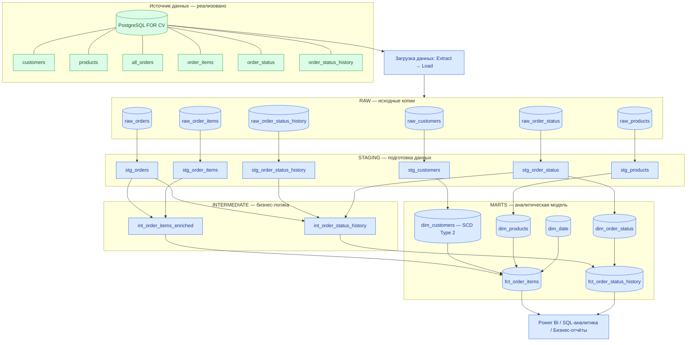

# Архитектура аналитического хранилища данных

Диаграмма показывает предполагаемый путь данных от операционной базы PostgreSQL `FOR CV` до аналитических витрин и BI-отчётности.

**Зелёным обозначен существующий источник данных. Синим — проектируемые слои архитектуры.**

## Обозначения

- **Source** — существующая операционная база PostgreSQL.
- **Raw** — исходные копии данных без существенных бизнес-преобразований.
- **Staging** — подготовка и стандартизация данных.
- **Intermediate** — объединение таблиц и применение общей бизнес-логики.
- **Marts** — факты и измерения для аналитики.
- **BI** — использование готовых данных в отчётности.

## Особенности проектируемой модели

- `fct_order_items` — факты по товарным позициям заказов.
- `fct_order_status_history` — история изменения статусов заказов.
- `dim_customers` — измерение клиентов с возможностью реализации SCD Type 2 на основе существующих атрибутов `full_name` и `email`.
- `dim_products` — измерение товаров.
- `dim_date` — календарное измерение.
- `dim_order_status` — справочник статусов заказов.

**Статус:** PostgreSQL `FOR CV` реализована ранее. Остальные слои описывают проектируемое решение и не являются реализованным DWH/dbt-пайплайном. Для отслеживания сегментов клиентов или рекламных кампаний потребуются дополнительные источники данных.
