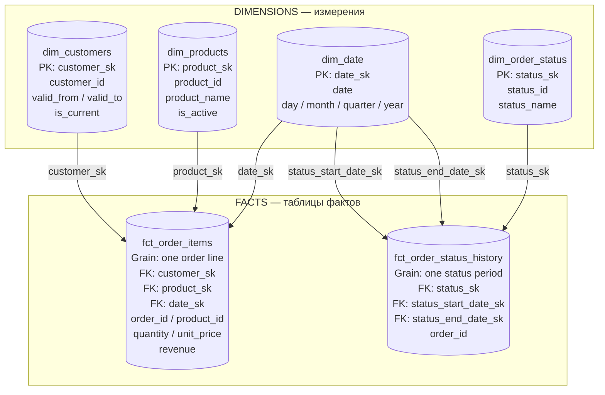

# Star Schema — аналитическая модель данных

Диаграмма показывает предполагаемую структуру аналитических витрин DWH. Центральные таблицы фактов связаны с таблицами измерений через суррогатные ключи.

## Описание таблиц

### 1. fct_order_items

**Зерно таблицы:** одна строка на одну товарную позицию заказа.

Основные показатели:
- `quantity` — количество товара.
- `unit_price` — цена товара на момент заказа.
- `revenue` — выручка по товарной позиции (`quantity × unit_price`).

Связи:
- `customer_sk` → `dim_customers.customer_sk`
- `product_sk` → `dim_products.product_sk`
- `date_sk` → `dim_date.date_sk`

### 2. fct_order_status_history

**Зерно таблицы:** одна строка на один период действия статуса заказа.

Связи:
- `status_sk` → `dim_order_status.status_sk`
- `status_start_date_sk` → `dim_date.date_sk`
- `status_end_date_sk` → `dim_date.date_sk`

### 3. Особенности модели

- `customer_sk` позволяет связать заказ с правильной исторической версией клиента по `order_date`.
- `dim_customers` проектируется с использованием SCD Type 2.
- `unit_price` берётся из товарной позиции заказа, а не из текущей цены каталога.
- `order_id` и `product_id` сохраняются как идентификаторы исходной системы для детализации и трассировки данных.
- Даты начала и окончания статуса используют одну таблицу `dim_date` в разных ролях.

**Статус:** Star Schema — проектируемая модель. Таблицы фактов и измерений пока не реализованы в DWH.
